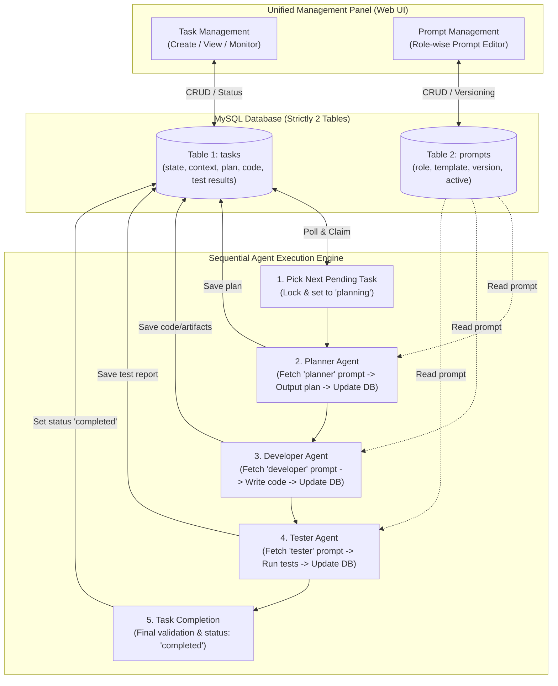
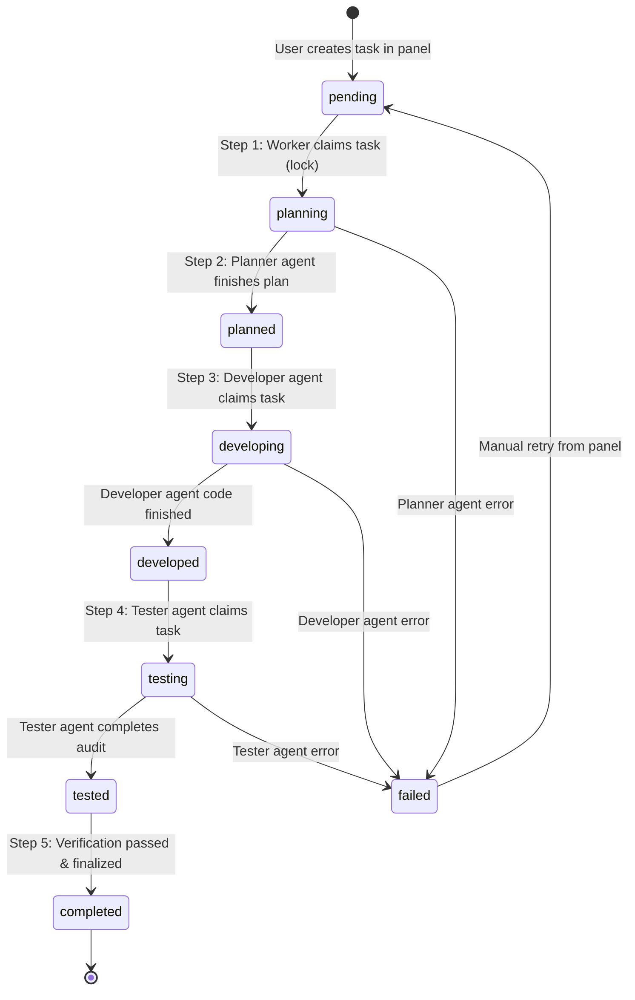
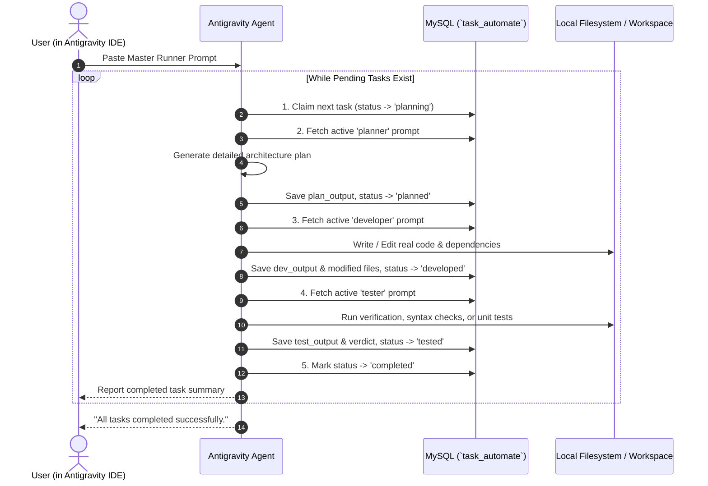

# AI Project Task Automation System — Specification & Implementation Plan

A lightweight, role-driven local autonomous task execution platform powered by **only 2 database tables** (`tasks` and `prompts`), a unified control panel, and a sequential multi-agent execution pipeline: **Planner &rarr; Developer &rarr; Tester &rarr; Complete**.

---

## 1. System Overview & Architecture



### Core Design Principles
1. **Minimalist Storage**: Exactly **two tables** handle the entire system. No extra dependency tables, no Redis required.
2. **Role-Driven Prompts**: Prompts are stored and versioned per role (`planner`, `developer`, `tester`). Prompts can be updated at runtime from the panel without restarting services.
3. **Strict Sequential State Machine**: A task progresses sequentially through defined stages. If any step fails, error state is captured and can be retried or inspected.
4. **Context Carry-Over**: Each role's output feeds directly into the next role's input payload.

---

## 2. Database Schema (2 Tables Only)

### Table 1: `tasks`
Stores task definitions, execution parameters, intermediate outputs from each agent stage, and the current lifecycle status.

```sql
CREATE TABLE IF NOT EXISTS `tasks` (
    `id` INT UNSIGNED AUTO_INCREMENT PRIMARY KEY,
    `title` VARCHAR(255) NOT NULL,
    `description` TEXT NOT NULL,
    `project_path` VARCHAR(500) NULL COMMENT 'Local directory path where agent runs',
    `status` ENUM(
        'pending',
        'planning',
        'planned',
        'developing',
        'developed',
        'testing',
        'tested',
        'completed',
        'failed'
    ) NOT NULL DEFAULT 'pending',
    `current_role` ENUM('planner', 'developer', 'tester', 'none') NOT NULL DEFAULT 'none',
    `plan_output` MEDIUMTEXT NULL COMMENT 'Markdown plan generated by Planner Agent',
    `dev_output` MEDIUMTEXT NULL COMMENT 'Code diffs, file changes, or execution logs by Developer Agent',
    `test_output` MEDIUMTEXT NULL COMMENT 'Test execution results and verification notes by Tester Agent',
    `error_log` TEXT NULL COMMENT 'Captured error message if any agent fails',
    `retry_count` INT UNSIGNED NOT NULL DEFAULT 0,
    `created_at` TIMESTAMP DEFAULT CURRENT_TIMESTAMP,
    `updated_at` TIMESTAMP DEFAULT CURRENT_TIMESTAMP ON UPDATE CURRENT_TIMESTAMP,
    INDEX `idx_status_created` (`status`, `created_at`),
    INDEX `idx_current_role` (`current_role`)
) ENGINE=InnoDB DEFAULT CHARSET=utf8mb4 COLLATE=utf8mb4_unicode_ci;
```

---

### Table 2: `prompts`
Stores role-wise system and user prompt templates with variable interpolation placeholders (e.g., `{{title}}`, `{{description}}`, `{{plan_output}}`).

```sql
CREATE TABLE IF NOT EXISTS `prompts` (
    `id` INT UNSIGNED AUTO_INCREMENT PRIMARY KEY,
    `role` ENUM('planner', 'developer', 'tester') NOT NULL,
    `title` VARCHAR(150) NOT NULL COMMENT 'Descriptive prompt name e.g., Standard Planner v1',
    `system_prompt` TEXT NOT NULL COMMENT 'System instruction defining agent persona and constraints',
    `user_prompt_template` MEDIUMTEXT NOT NULL COMMENT 'Prompt template with {{variables}} for task execution',
    `model_name` VARCHAR(100) NOT NULL DEFAULT 'gemini-1.5-pro' COMMENT 'LLM model targeted for this role',
    `temperature` DECIMAL(3,2) NOT NULL DEFAULT 0.20,
    `is_active` TINYINT(1) NOT NULL DEFAULT 1 COMMENT '1 = active prompt used for this role, 0 = disabled',
    `version` INT UNSIGNED NOT NULL DEFAULT 1,
    `created_at` TIMESTAMP DEFAULT CURRENT_TIMESTAMP,
    `updated_at` TIMESTAMP DEFAULT CURRENT_TIMESTAMP ON UPDATE CURRENT_TIMESTAMP,
    UNIQUE KEY `uniq_role_active` (`role`, `is_active`, `version`),
    INDEX `idx_role_active` (`role`, `is_active`)
) ENGINE=InnoDB DEFAULT CHARSET=utf8mb4 COLLATE=utf8mb4_unicode_ci;
```

---

## 3. Role-Wise Prompt Templates & Variable Substitution

Each agent replaces template tags dynamically before dispatching to the LLM.

### Variable Reference Table

| Variable | Populated By | Available To | Description |
| :--- | :--- | :--- | :--- |
| `{{task_id}}` | System | All Roles | Unique task primary key |
| `{{title}}` | User / Task | All Roles | Task title |
| `{{description}}` | User / Task | All Roles | Full task description & requirements |
| `{{project_path}}` | User / Task | All Roles | Working directory path on local machine |
| `{{plan_output}}` | Planner Agent | Developer, Tester | Generated implementation blueprint |
| `{{dev_output}}` | Developer Agent | Tester | Files created/modified, code changes & log |
| `{{test_output}}` | Tester Agent | Final Review | Test runner output & pass/fail verdicts |

---

### Initial Prompt Seeds

```sql
-- 1. Planner Prompt
INSERT INTO `prompts` (`role`, `title`, `system_prompt`, `user_prompt_template`, `model_name`, `temperature`, `is_active`, `version`)
VALUES (
    'planner',
    'Default Sequential Planner',
    'You are an expert Software Architect and Technical Planner. Your job is to analyze task requirements and create an actionable, step-by-step implementation plan for a developer and tester. Do not write full code. Produce clear steps, file paths, and test cases.',
    'Task #{{task_id}}: {{title}}
Project Directory: {{project_path}}

Requirement Description:
{{description}}

Produce an actionable plan in Markdown format with the following sections:
1. Architecture & Design Decisions
2. Target Files to Create or Modify
3. Step-by-Step Implementation Steps
4. Verification & Testing Strategy',
    'gemini-1.5-pro',
    0.20,
    1,
    1
);

-- 2. Developer Prompt
INSERT INTO `prompts` (`role`, `title`, `system_prompt`, `user_prompt_template`, `model_name`, `temperature`, `is_active`, `version`)
VALUES (
    'developer',
    'Default Autonomous Developer',
    'You are a Senior Full-Stack Software Engineer. Your job is to implement the exact plan provided by the Software Architect. Write production-quality, tested, clean code adhering to best practices.',
    'Task #{{task_id}}: {{title}}
Project Directory: {{project_path}}

Original Requirement:
{{description}}

Architect Plan:
{{plan_output}}

Execute the plan:
1. Provide the complete code for all new or modified files.
2. Clearly mark file paths using "### FILE: path/to/file.ext".
3. Provide bash commands required to install dependencies or run the code.
4. Summarize all changes performed.',
    'gemini-1.5-pro',
    0.10,
    1,
    1
);

-- 3. Tester Prompt
INSERT INTO `prompts` (`role`, `title`, `system_prompt`, `user_prompt_template`, `model_name`, `temperature`, `is_active`, `version`)
VALUES (
    'tester',
    'Default QA & Verification Engineer',
    'You are a Lead QA and Test Automation Engineer. Your job is to review the code changes against the original requirements and plan, execute test cases or mock executions, verify syntax and logic, and provide a PASS/FAIL verdict.',
    'Task #{{task_id}}: {{title}}
Project Directory: {{project_path}}

Original Requirement:
{{description}}

Architect Plan:
{{plan_output}}

Developer Code & Output:
{{dev_output}}

Perform comprehensive verification:
1. Review code syntax, logic bugs, security edge cases.
2. Verify all acceptance criteria from the plan.
3. Provide automated unit/integration test scripts or command lines to execute.
4. State explicit Verdict: [PASS] or [FAIL] with detailed reasoning.',
    'gemini-1.5-pro',
    0.05,
    1,
    1
);
```

---

## 4. The 5-Step Sequential Workflow Engine



### Detailed Step Breakdown

#### Step 1: Pick Task (Worker Polling)
- Worker executes atomic claim query to avoid race conditions:
  ```sql
  UPDATE tasks
  SET status = 'planning', current_role = 'planner', updated_at = NOW()
  WHERE status = 'pending'
  ORDER BY id ASC
  LIMIT 1;
  ```
- If a row was updated, fetch the task record (`SELECT * FROM tasks WHERE status = 'planning' AND current_role = 'planner' LIMIT 1;`).

#### Step 2: Planner Agent
1. Fetch active prompt for role `'planner'`:
   ```sql
   SELECT system_prompt, user_prompt_template, model_name, temperature
   FROM prompts WHERE role = 'planner' AND is_active = 1 LIMIT 1;
   ```
2. Replace `{{task_id}}`, `{{title}}`, `{{description}}`, `{{project_path}}`.
3. Call LLM API (Gemini / Claude / OpenAI / Ollama).
4. Save plan and transition to `planned`:
   ```sql
   UPDATE tasks
   SET plan_output = :plan_markdown,
       status = 'planned',
       current_role = 'none'
   WHERE id = :task_id;
   ```

#### Step 3: Developer Agent
1. Automatically or via trigger, pick the `planned` task:
   ```sql
   UPDATE tasks
   SET status = 'developing', current_role = 'developer'
   WHERE id = :task_id AND status = 'planned';
   ```
2. Fetch active prompt for role `'developer'`.
3. Inject `{{plan_output}}` along with task details.
4. Call LLM / run development tool.
5. Save code output, file changes, and transition to `developed`:
   ```sql
   UPDATE tasks
   SET dev_output = :code_changes,
       status = 'developed',
       current_role = 'none'
   WHERE id = :task_id;
   ```

#### Step 4: Tester Agent
1. Pick the `developed` task:
   ```sql
   UPDATE tasks
   SET status = 'testing', current_role = 'tester'
   WHERE id = :task_id AND status = 'developed';
   ```
2. Fetch active prompt for role `'tester'`.
3. Inject `{{plan_output}}` and `{{dev_output}}`.
4. Run static validation, run test commands locally if configured, or prompt LLM for code verification.
5. Save test report and transition to `tested`:
   ```sql
   UPDATE tasks
   SET test_output = :test_report,
       status = 'tested',
       current_role = 'none'
   WHERE id = :task_id;
   ```

#### Step 5: Complete & Final Update
1. Check if test verdict contains `[FAIL]` or errors:
   - If `FAIL` & retries < max: optionally route back to `developing` or mark `failed`.
   - If `PASS`:
     ```sql
     UPDATE tasks
     SET status = 'completed',
         current_role = 'none'
     WHERE id = :task_id AND status = 'tested';
     ```
2. Real-time badge in panel updates to **Completed**.

---

## 5. Control Panel UI Design

A clean, responsive single-page or dual-tab web dashboard (HTML/PHP or React/Next.js):

### Panel Views
1. **Header Navigation**:
   - Tab 1: **Tasks Board** (Task creation, live status, step-by-step agent outputs)
   - Tab 2: **Role Prompts** (Role-wise prompt editor for Planner, Developer, Tester)
   - Action Button: **"Run Worker Once"** / **"Toggle Auto-Runner"**

2. **Tab 1: Task Management Panel**:
   - **Task Creation Form**:
     - Task Title (`input`)
     - Description / Requirements (`textarea`)
     - Project Directory Path (`input`)
     - Button: *Create Task (Status: Pending)*
   - **Task List Table**:
     - Columns: ID, Title, Current Status (Badge with colors: Pending: Gray, Planning: Blue, Planned: Indigo, Developing: Yellow, Developed: Orange, Testing: Purple, Completed: Green, Failed: Red), Current Role, Created At, Actions (View Details, Run Step, Retry, Delete).
   - **Task Detail Drawer / Modal**:
     - Displays 3 collapsible tabs or accordion cards:
       - **1. Plan** (renders `plan_output` markdown)
       - **2. Development Output** (renders `dev_output` with syntax highlighting / diffs)
       - **3. Test Results** (renders `test_output` with pass/fail badges)

3. **Tab 2: Role-Wise Prompt Editor**:
   - 3 sub-panels or cards:
     - **Planner Prompt**: System prompt, User template, Model, Temperature.
     - **Developer Prompt**: System prompt, User template, Model, Temperature.
     - **Tester Prompt**: System prompt, User template, Model, Temperature.
   - Variable Helper Pills: Click `{{plan_output}}` to insert into cursor position.
   - Save button with live validation.

---

## 6. Implementation File Structure (Local System)

```
automation-development/
├── config/
│   └── db.php                  # Database connection (PDO MySQL)
├── api/
│   ├── tasks.php               # CRUD API for tasks (GET, POST, PUT, DELETE)
│   ├── prompts.php             # CRUD API for role prompts (GET, POST, PUT)
│   └── run_step.php            # Endpoint to trigger 1 step or whole pipeline
├── runner/
│   ├── agent_runner.php        # CLI/Cron script to pick tasks & dispatch LLM
│   └── llm_client.php          # LLM API caller (Gemini / Anthropic / OpenAI / Ollama)
├── public/
│   ├── index.html              # Main dashboard panel (Tailwind CSS + Alpine.js / Vanilla JS)
│   ├── js/
│   │   └── app.js              # Panel logic: task creation, prompt editing, polling
│   └── css/
│       └── style.css
├── schema.sql                  # Database creation script (2 tables)
├── project-generator-task-automate.md # This specification document
└── task.md                     # Architectural reference
```

---

## 7. Core Scripts Implementation Reference

### Database Connection (`config/db.php`)
```php
<?php
$host = getenv('DB_HOST') ?: '127.0.0.1';
$db   = getenv('DB_NAME') ?: 'task_automate';
$user = getenv('DB_USER') ?: 'root';
$pass = getenv('DB_PASS') ?: '';
$charset = 'utf8mb4';

$dsn = "mysql:host=$host;dbname=$db;charset=$charset";
$options = [
    PDO::ATTR_ERRMODE            => PDO::ERRMODE_EXCEPTION,
    PDO::ATTR_DEFAULT_FETCH_MODE => PDO::FETCH_ASSOC,
    PDO::ATTR_EMULATE_PREPARES   => false,
];

try {
    $pdo = new PDO($dsn, $user, $pass, $options);
} catch (\PDOException $e) {
    throw new \PDOException($e->getMessage(), (int)$e->getCode());
}
```

---

### Step-by-Step Task Worker (`runner/agent_runner.php`)
```php
<?php
require_once __DIR__ . '/../config/db.php';
require_once __DIR__ . '/llm_client.php';

function pickAndExecuteNextStep(PDO $pdo) {
    // 1. Pick a task that needs work
    $stmt = $pdo->prepare("
        SELECT * FROM tasks 
        WHERE status IN ('pending', 'planned', 'developed') 
        ORDER BY FIELD(status, 'developed', 'planned', 'pending'), id ASC 
        LIMIT 1
    ");
    $stmt->execute();
    $task = $stmt->fetch();

    if (!$task) {
        echo "[INFO] No active tasks to process.\n";
        return;
    }

    $taskId = $task['id'];

    // Route based on current status
    if ($task['status'] === 'pending') {
        // Step 1 & 2: Plan
        runAgentRole($pdo, $taskId, 'planner', 'planning', 'planned', 'plan_output');
    } elseif ($task['status'] === 'planned') {
        // Step 3: Develop
        runAgentRole($pdo, $taskId, 'developer', 'developing', 'developed', 'dev_output');
    } elseif ($task['status'] === 'developed') {
        // Step 4 & 5: Test and Complete
        runAgentRole($pdo, $taskId, 'tester', 'testing', 'tested', 'test_output');
        finalizeTask($pdo, $taskId);
    }
}

function runAgentRole(PDO $pdo, $taskId, $role, $inProgressStatus, $doneStatus, $outputColumn) {
    echo "[START] Task #$taskId: Running $role...\n";

    // Update to in-progress
    $pdo->prepare("UPDATE tasks SET status = ?, current_role = ? WHERE id = ?")
        ->execute([$inProgressStatus, $role, $taskId]);

    // Fetch Task & Prompt
    $tStmt = $pdo->prepare("SELECT * FROM tasks WHERE id = ?");
    $tStmt->execute([$taskId]);
    $task = $tStmt->fetch();

    $pStmt = $pdo->prepare("SELECT * FROM prompts WHERE role = ? AND is_active = 1 LIMIT 1");
    $pStmt->execute([$role]);
    $prompt = $pStmt->fetch();

    if (!$prompt) {
        $pdo->prepare("UPDATE tasks SET status = 'failed', error_log = ? WHERE id = ?")
            ->execute(["No active prompt configured for role: $role", $taskId]);
        return;
    }

    // Substitute variables
    $userPrompt = str_replace(
        ['{{task_id}}', '{{title}}', '{{description}}', '{{project_path}}', '{{plan_output}}', '{{dev_output}}'],
        [$task['id'], $task['title'], $task['description'], $task['project_path'] ?? '', $task['plan_output'] ?? '', $task['dev_output'] ?? ''],
        $prompt['user_prompt_template']
    );

    try {
        $aiResult = callLLM($prompt['system_prompt'], $userPrompt, $prompt['model_name'], (float)$prompt['temperature']);

        // Update task with output
        $pdo->prepare("UPDATE tasks SET $outputColumn = ?, status = ?, current_role = 'none' WHERE id = ?")
            ->execute([$aiResult, $doneStatus, $taskId]);

        echo "[SUCCESS] Task #$taskId: $role finished.\n";
    } catch (Exception $e) {
        $pdo->prepare("UPDATE tasks SET status = 'failed', error_log = ? WHERE id = ?")
            ->execute([$e->getMessage(), $taskId]);
        echo "[ERROR] Task #$taskId failed at $role: " . $e->getMessage() . "\n";
    }
}

function finalizeTask(PDO $pdo, $taskId) {
    $stmt = $pdo->prepare("SELECT test_output FROM tasks WHERE id = ?");
    $stmt->execute([$taskId]);
    $task = $stmt->fetch();

    // If test succeeded, mark completed
    $pdo->prepare("UPDATE tasks SET status = 'completed', current_role = 'none' WHERE id = ?")
        ->execute([$taskId]);
    echo "[COMPLETED] Task #$taskId marked completed.\n";
}
```

---

## 8. Step-by-Step Setup Guide

### 1. Initialize MySQL Database
1. Open XAMPP and start **MySQL** and **Apache**.
2. Open phpMyAdmin (`http://localhost/phpmyadmin`) or MySQL CLI:
   ```bash
   mysql -u root -p
   ```
3. Run the schema creation:
   ```sql
   CREATE DATABASE IF NOT EXISTS `task_automate` CHARACTER SET utf8mb4 COLLATE utf8mb4_unicode_ci;
   USE `task_automate`;
   -- Execute the SQL tables and prompt seeds from Section 2 & 3
   ```

### 2. Configure Environment
Set your API key (e.g. Gemini or OpenAI) in your environment or configuration file:
```bash
export GEMINI_API_KEY="your_api_key_here"
```

### 3. Run the System
- **Web UI**: Open `http://localhost/Project/automation-development/public/` in your browser.
- **Background Worker**: Run in terminal:
  ```bash
  php runner/agent_runner.php
  ```
- Or run continuously in a loop:
  ```bash
  while true; do php runner/agent_runner.php; sleep 5; done
  ```

---

## 9. Antigravity IDE Execution Mode (Paste & Run)

In addition to running an external background PHP worker, you can execute the entire pipeline **directly inside the Antigravity IDE chat interface**. 

When you paste the Master Runner Prompt into Antigravity IDE, Antigravity itself acts as the autonomous agent: it reads the database, adopts each role dynamically according to the `prompts` table, writes real code into your workspace, verifies the work, and updates the task status in MySQL step by step.



---

### 9.1 Helper CLI Bridge (`runner/db_helper.php`)

To make it effortless and 100% reliable for Antigravity IDE to query and update the database without shell escaping issues, a small JSON CLI helper is provided:

```php
<?php
// runner/db_helper.php
require_once __DIR__ . '/../config/db.php';

$action = $argv[1] ?? '';

header('Content-Type: application/json');

switch ($action) {
    case 'pick_task':
        // Claim next pending task
        $pdo->beginTransaction();
        $stmt = $pdo->query("SELECT * FROM tasks WHERE status = 'pending' ORDER BY id ASC LIMIT 1 FOR UPDATE");
        $task = $stmt->fetch();
        if ($task) {
            $pdo->prepare("UPDATE tasks SET status = 'planning', current_role = 'planner' WHERE id = ?")
                ->execute([$task['id']]);
            $pdo->commit();
            echo json_encode(['success' => true, 'task' => $task]);
        } else {
            $pdo->commit();
            echo json_encode(['success' => false, 'message' => 'No pending tasks']);
        }
        break;

    case 'get_prompt':
        $role = $argv[2] ?? '';
        $stmt = $pdo->prepare("SELECT * FROM prompts WHERE role = ? AND is_active = 1 LIMIT 1");
        $stmt->execute([$role]);
        $prompt = $stmt->fetch();
        echo json_encode(['success' => (bool)$prompt, 'prompt' => $prompt]);
        break;

    case 'update_status':
        // Usage: php runner/db_helper.php update_status <id> <status> <current_role> <output_column> <file_containing_output>
        $taskId = (int)($argv[2] ?? 0);
        $status = $argv[3] ?? '';
        $role   = $argv[4] ?? 'none';
        $col    = $argv[5] ?? '';
        $file   = $argv[6] ?? '';

        $content = ($file && file_exists($file)) ? file_get_contents($file) : '';

        if ($col && in_array($col, ['plan_output', 'dev_output', 'test_output', 'error_log'])) {
            $sql = "UPDATE tasks SET status = :status, current_role = :role, $col = :val WHERE id = :id";
            $stmt = $pdo->prepare($sql);
            $stmt->execute(['status' => $status, 'role' => $role, 'val' => $content, 'id' => $taskId]);
        } else {
            $sql = "UPDATE tasks SET status = :status, current_role = :role WHERE id = :id";
            $stmt = $pdo->prepare($sql);
            $stmt->execute(['status' => $status, 'role' => $role, 'id' => $taskId]);
        }
        echo json_encode(['success' => true]);
        break;

    default:
        echo json_encode(['error' => 'Unknown action. Actions: pick_task, get_prompt, update_status']);
        break;
}
```

---

### 9.2 The Antigravity IDE Master Runner Prompt (Copy & Paste)

Copy the prompt block below and paste it directly into the Antigravity chat window whenever you want Antigravity to autonomously process tasks from your local database:

````markdown
You are the Autonomous Task Execution Engine for this local project. 
Your goal is to autonomously pick tasks from the MySQL database (`task_automate`) one by one, execute them through a strict 3-role sequential workflow (Planner -> Developer -> Tester), and update their status in the database until completion.

### Execution Protocol:
Work in a loop. For each task:

#### Step 1: Pick Next Pending Task
Run command:
`php /Applications/XAMPP/xamppfiles/htdocs/Project/automation-development/runner/db_helper.php pick_task`
Or directly execute SQL:
```sql
UPDATE tasks SET status = 'planning', current_role = 'planner' WHERE status = 'pending' ORDER BY id ASC LIMIT 1;
SELECT * FROM tasks WHERE status = 'planning' AND current_role = 'planner' ORDER BY id ASC LIMIT 1;
```
If no task is returned, output "No pending tasks found. All tasks are up to date." and STOP.

#### Step 2: Role 1 — Planner Agent
1. Fetch the active prompt for role `planner`:
   `php /Applications/XAMPP/xamppfiles/htdocs/Project/automation-development/runner/db_helper.php get_prompt planner`
2. Adopt the Persona & instructions from `system_prompt`.
3. In `user_prompt_template`, substitute `{{task_id}}`, `{{title}}`, `{{description}}`, `{{project_path}}`.
4. Produce a detailed step-by-step Technical Implementation Plan (architecture, target file paths, logic changes, test cases).
5. Save the generated plan to `/tmp/plan.md`.
6. Update DB status:
   `php /Applications/XAMPP/xamppfiles/htdocs/Project/automation-development/runner/db_helper.php update_status <TASK_ID> planned none plan_output /tmp/plan.md`

#### Step 3: Role 2 — Developer Agent
1. Update status to developing:
   `php /Applications/XAMPP/xamppfiles/htdocs/Project/automation-development/runner/db_helper.php update_status <TASK_ID> developing developer`
2. Fetch the active prompt for role `developer`:
   `php /Applications/XAMPP/xamppfiles/htdocs/Project/automation-development/runner/db_helper.php get_prompt developer`
3. Adopt the Persona from `system_prompt`.
4. In `user_prompt_template`, substitute `{{plan_output}}` with the plan from Step 2, alongside `{{title}}` and `{{description}}`.
5. **IMPLEMENT THE CODE**: Use `write_file` or `edit_file` to create or update the real files in the workspace according to the plan.
6. Summarize the changes made and file paths into `/tmp/dev.md`.
7. Update DB status:
   `php /Applications/XAMPP/xamppfiles/htdocs/Project/automation-development/runner/db_helper.php update_status <TASK_ID> developed none dev_output /tmp/dev.md`

#### Step 4: Role 3 — Tester Agent
1. Update status to testing:
   `php /Applications/XAMPP/xamppfiles/htdocs/Project/automation-development/runner/db_helper.php update_status <TASK_ID> testing tester`
2. Fetch the active prompt for role `tester`:
   `php /Applications/XAMPP/xamppfiles/htdocs/Project/automation-development/runner/db_helper.php get_prompt tester`
3. Adopt the Persona from `system_prompt`.
4. Verify the created files: run syntax checks (e.g. `php -l`, `node --check`), verify functionality, or run test suites.
5. Compile the test summary and state explicit verdict `[PASS]` or `[FAIL]` into `/tmp/test.md`.
6. Update DB status:
   `php /Applications/XAMPP/xamppfiles/htdocs/Project/automation-development/runner/db_helper.php update_status <TASK_ID> tested none test_output /tmp/test.md`

#### Step 5: Complete & Repeat
1. If verdict is `[PASS]`:
   `php /Applications/XAMPP/xamppfiles/htdocs/Project/automation-development/runner/db_helper.php update_status <TASK_ID> completed none`
   Report to the user: "Task #<ID> (<TITLE>) successfully completed."
2. Immediately proceed to **Step 1** to pick the next pending task. Continue until all tasks are complete.
````

---

## 10. Verification & Testing Checklist

- [ ] **Table 1 (`tasks`) created** with all 9 statuses and output columns (`plan_output`, `dev_output`, `test_output`).
- [ ] **Table 2 (`prompts`) created** with role enum (`planner`, `developer`, `tester`) and template fields.
- [ ] **Initial seed prompts inserted** for all 3 roles.
- [ ] **Web Panel displays** task creation form and role prompt editor.
- [ ] **CLI Helper (`runner/db_helper.php`) tested** with `pick_task`, `get_prompt`, and `update_status`.
- [ ] **Antigravity IDE Prompt execution**:
  - [ ] Pasting Master Prompt claims task (`pending` &rarr; `planning`)
  - [ ] Planner creates plan and updates status (`planning` &rarr; `planned`)
  - [ ] Developer writes actual workspace files and updates status (`planned` &rarr; `developed`)
  - [ ] Tester validates files and updates status (`developed` &rarr; `tested`)
  - [ ] Task marked `completed` and automatically picks next task.
- [ ] **Error handling**: Tasks mark `failed` if prompt is missing or syntax errors occur, with retry capability.


